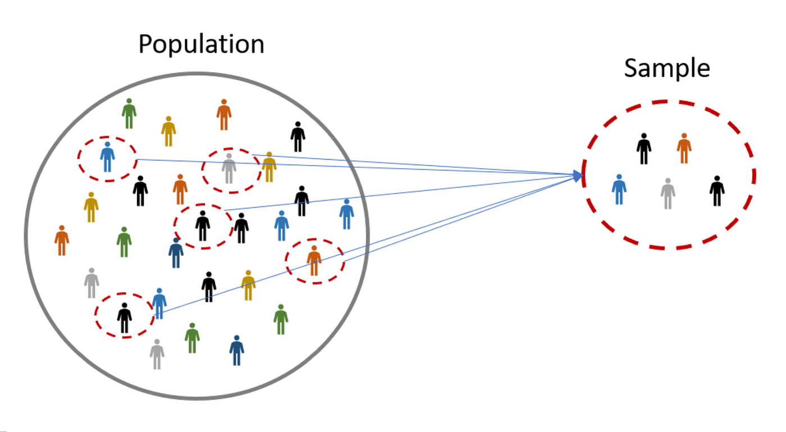

# Statistics Theory

Core statistical ideas used in machine learning. Concepts only — no code.

## Contents

1. [What is statistics?](#what-is-statistics)
2. [Branches of statistics](#branches-of-statistics)
3. [Types of data](#types-of-data)
4. [Types of variables](#types-of-variables)
5. [Population and sample](#population-and-sample)
6. [Probability (brief)](#probability-brief)
7. [Descriptive statistics (measures)](#descriptive-statistics-measures)
8. [Distributions](#distributions)
9. [Sampling](#sampling)
10. [Estimation](#estimation)
11. [Confidence intervals](#confidence-intervals)
12. [Hypothesis testing](#hypothesis-testing)
13. [Correlation and regression](#correlation-and-regression)
14. [Bias and variance (ML view)](#bias-and-variance-ml-view)
15. [Correlation vs causation](#correlation-vs-causation)
16. [Why this matters for ML](#why-this-matters-for-ml)

## What is statistics?

Statistics is a branch of mathematics for collecting, analyzing, interpreting, presenting, and organizing data so you can make decisions or predictions from it.

In practice it answers questions like:

- What patterns exist in this dataset?
- How confident is this estimate?
- Did a change really help, or is the difference just noise?

### Key concepts

| Concept | Role |
| --- | --- |
| Descriptive statistics | Summarize what you already have |
| Inferential statistics | Generalize from a sample to a population |
| Probability | Formal language for uncertainty and chance |
| Population vs sample | The full set vs what you observed |
| Hypothesis testing | Decide whether data contradict a default claim |
| Correlation and regression | Measure and model relationships |
| Variance and standard deviation | Quantify spread |

## Branches of statistics

Statistics is usually split into two major branches. Most ML workflows use both: descriptive tools during EDA, and inferential ideas when judging metrics, A/B tests, or model comparisons.

### Descriptive

Descriptive statistics summarize and describe the data you already have, **without** generalizing beyond that sample.

- **Question it answers:** What does the data look like?
- **Typical steps:** measure center (mean/median), spread (range/variance/SD), shape (skew), then plot (histogram, box plot)
- **Examples:** mean, median, mode, range, variance, standard deviation, percentile, quartile, histogram, box plot, frequency table

### Inferential

Inferential statistics uses a **sample** to draw conclusions about a larger **population**, while accounting for uncertainty.

- **Goal:** Draw conclusions that go beyond the observed data
- **Why uncertainty matters:** every sample is one of many possible samples, so estimates bounce around
- **Examples:** estimation, confidence intervals, hypothesis testing, regression and relationships

| Branch | Scope | Typical output |
| --- | --- | --- |
| Descriptive | This dataset only | Summary numbers and plots |
| Inferential | Beyond this dataset | Estimates, intervals, p-values, models |

**Quick check:** if you only describe *this* CSV, you are doing descriptive work. If you claim something about *all* customers, *next week’s* traffic, or a true effect size, you have stepped into inference.

## Types of data

Data can be classified in three ways: by structure, by time dimension, and by number of variables. The same dataset can fit more than one bucket (for example, a structured multivariate time series).

```text
Data
├── Type 1 — Structure
│   ├── Structured
│   └── Unstructured
├── Type 2 — Time dimension
│   ├── Cross-sectional
│   └── Time series
└── Type 3 — Number of variables
    ├── Univariate
    └── Multivariate
```

| Classification | Type | Meaning / examples | Why it matters |
| --- | --- | --- | --- |
| Structure | Structured | Tables, spreadsheets, relational databases | Fits rows/columns; easy for classical ML |
| Structure | Unstructured | Multimedia, text, web pages | Needs parsing, embeddings, or NLP/CV pipelines |
| Time dimension | Cross-sectional | Collected at a single point in time | No order over time; rows are often treated as independent |
| Time dimension | Time series | Collected over a sequence of time intervals | Order and lag matter; random shuffles can leak future into past |
| Number of variables | Univariate | Single variable | Simple distributions and summaries |
| Number of variables | Multivariate | Two or more variables | Relationships, multicollinearity, joint models |

**Semi-structured** data (JSON, logs with mixed fields) sits between structured and unstructured: partly parseable, but not a clean table until you flatten it.

## Types of variables

The type of variable decides how you encode features, which plots make sense, and which models or metrics are valid.

```text
Variables
├── Categorical (labels or groups)
│   ├── Nominal — no natural order
│   └── Ordinal — natural order
└── Numerical (quantities or measurements)
    ├── Interval — no true zero
    └── Ratio — true zero
```

### Categorical variables

Categorical variables are groups, classes, or labels — not numerical quantities. Arithmetic like “average city” is usually meaningless until you encode the categories for a model.

#### Nominal variables

Nominal variables have categories with **no ranking or order**.

| Variable | Possible values |
| --- | --- |
| City | Indore, Mumbai, Delhi |
| Color | Red, Blue, Green |
| Programming language | Python, Java, Go |

You cannot say Mumbai is “greater than” Delhi, or that Python ranks above Java.

**In ML:** Use them when predicting a customer’s city, or when encoding product types as features. A common technique is **one-hot encoding** — each category becomes its own 0/1 column so the model does not invent a false order.

One-hot encoding example (color):

| Color | R | G | B |
| --- | --- | --- | --- |
| R | 1 | 0 | 0 |
| G | 0 | 1 | 0 |
| B | 0 | 0 | 1 |

With many categories, one-hot tables get wide (high cardinality). Alternatives include target encoding, feature hashing, or embeddings — always with care for leakage.

#### Ordinal variables

Ordinal variables have categories with a **natural order** (for example low / medium / high, or rating 1–5), but the gaps between levels are not always equal. “High” ranks above “medium,” yet the step from low→medium may not match medium→high.

| Variable | Ordered values (low → high) |
| --- | --- |
| Satisfaction | Poor → Fair → Good → Excellent |
| Education | High school → Bachelor’s → Master’s → PhD |
| Ticket priority | P3 → P2 → P1 |

**In ML:** Map them to integers (1, 2, 3) when order matters, but do not treat them as continuous unless the spacing assumption is reasonable. Tree-based models often handle ordinal integers well; linear models assume equal spacing if you feed raw integers.

### Numerical variables

Numerical variables are quantities or measurements. You can compare magnitudes and, with care, compute differences and averages.

| Type | Meaning | Example | Allowed operations |
| --- | --- | --- | --- |
| Interval | Ordered values with equal gaps, but **no true zero** | Temperature in °C | Differences make sense; ratios often do not (20°C is not “twice as hot” as 10°C) |
| Ratio | Ordered values with equal gaps and a **true zero** | Height, weight, income, counts | Differences and ratios both make sense |

**Discrete vs continuous:** counts are discrete (0, 1, 2, …); measurements like height are continuous (any value in a range, given precision).

**Scaling tip:** many models prefer numerical features on similar scales (standardization or min–max). Scaling does not fix a wrong variable type.

## Population and sample



| Term | Meaning                                                                | Example                                                                        |
| --- |------------------------------------------------------------------------|--------------------------------------------------------------------------------|
| Population | Full set of observations you care about or Entire group of individuals | All users, all invoices this year, all possible clicks, populatioin of country |
| Sample | Subset you actually observe                                            | Logged users last week, a random 10k rows                                      |
| Parameter | Number that describes the population                                   | True mean μ, true conversion rate                                              |
| Statistic | Number that describes the sample                                       | Sample mean x̄, sample conversion rate                                         |

- Statistics estimates population properties from samples.
- A good sample is **representative**; a biased sample systematically misses or overweights parts of the population.
- In ML, the “population” is often **future data from the same process**. Train, validation, and test splits are samples meant to stand in for that future.
- If the process changes (new product, new season, new market), yesterday’s sample may no longer represent tomorrow’s population — that is **distribution shift**.

### Why do we sample?

- **Cost:** Measuring everyone is expensive (surveys, labels, lab tests, compute).
- **Time:** Collecting the full population can take too long for decisions you need now.
- **Access:** The full population may be unavailable (future users, private data, infinite or streaming events).
- **Feasibility:** Some populations are huge or unbounded — a sample is the only practical option.
- **Quality:** Careful sampling can give accurate estimates with far fewer observations than a messy full census.
- **ML practice:** Models train on samples (batches, splits) and are judged on held-out samples that stand in for unseen data.

## Probability (brief)

Probability is the language statistics uses for uncertainty.

- An **event** is an outcome or set of outcomes (for example “user clicks”).
- Probabilities lie between 0 and 1. Mutually exclusive outcomes that cover everything sum to 1.
- **Independence:** knowing one event happened does not change the probability of another.
- **Conditional probability** P(A|B) is the probability of A given that B occurred.
- **Bayes’ idea (intuition):** update your belief about a hypothesis after seeing new evidence.

You do not need deep probability theory to start ML, but you do need comfort with “chance,” “given that,” and “on average.”

## Descriptive statistics (measures)

These measures summarize a sample without claiming anything about a larger population. Use several together — the mean alone can hide skew and outliers.

### Measures of center

| Measure | What it describes | When it helps |
| --- | --- | --- |
| Mean | Average value | Symmetric data without extreme outliers |
| Median | Middle value when sorted | Skewed data or outliers |
| Mode | Most frequent value | Categories or multimodal distributions |

Example: incomes {30k, 32k, 35k, 40k, 500k} — the mean is pulled up by 500k; the median better reflects a “typical” person.

### Measures of spread

| Measure | What it describes | Notes |
| --- | --- | --- |
| Variance | Average squared distance from the mean | Units are squared; sensitive to outliers |
| Standard deviation (SD) | Square root of variance | Same units as the data; common scale for spread |
| Range | Max − min | Simple but fragile to extremes |
| IQR | Q3 − Q1 (middle 50%) | Robust spread for box plots |
| Percentile / quartile | Position within ordered data | Q1 = 25th, Q2 = median, Q3 = 75th |

Rough reading of SD (for roughly normal data): about 68% of values fall within 1 SD of the mean, and about 95% within 2 SD.

### Shape

| Measure | What it describes |
| --- | --- |
| Skewness | Asymmetry — right-skewed means a long right tail (mean often > median) |
| Kurtosis | How heavy the tails are relative to a normal distribution |

**Rule of thumb:** if mean and median differ a lot, check skew and outliers before trusting the mean.

## Distributions

A **probability distribution** assigns probabilities to outcomes. It is the theoretical shape you assume or estimate for a random variable’s behavior.

| Kind | Outcomes | Function | Examples |
| --- | --- | --- | --- |
| Discrete | Countable | **PMF** (probability mass) | Bernoulli, Binomial, Poisson |
| Continuous | On a continuum | **PDF** (density; area = probability) | Normal, Uniform, Exponential |

- **CDF:** cumulative distribution function — P(X ≤ x).
- The **Normal (Gaussian)** is central because of the **central limit theorem**: sample means of i.i.d. data tend toward a normal shape as n grows.
- Other useful shapes: Bernoulli (binary), Binomial (count of successes in n trials), Poisson (counts of rare events), Exponential (waiting times).

Knowing the approximate distribution guides which tests, intervals, and loss functions are reasonable. Many ML losses (squared error, cross-entropy) quietly assume something about the noise or label distribution.

## Sampling

How you draw the sample shapes every later conclusion. A fancier model cannot fix bad sampling.

| Idea | Meaning |
| --- | --- |
| Sampling frame | List or process from which you draw units (users, invoices, devices) |
| Sampling bias | Systematic error from how data was collected (survivors only, volunteers only) |
| Sampling variability | Different samples give different estimates — expected, not a bug |
| Sample size | Larger samples usually reduce variance of estimates; they do **not** remove bias |

Sampling methods fall into two families:

- **Probability (random) sampling** — every unit has a known chance of selection. Supports unbiased estimation and valid confidence intervals when done correctly.
- **Non-probability sampling** — selection is not fully random. Faster and cheaper, but harder to generalize; bias is often unknown.

### Sampling techniques

```text
Sampling techniques
├── Probability
│   ├── Random (simple random)
│   ├── Systematic
│   ├── Stratified
│   └── Cluster
└── Non-probability
    ├── Quota
    └── Convenience
```

#### 1. Random sampling (simple random sample)

Every unit in the population (or frame) has an **equal** chance of being chosen, and every subset of a given size is equally likely.

- **How:** number the frame, then draw with a random number generator (or lottery) without favoring any unit.
- **Strengths:** conceptually clean; underpins many classical estimators and intervals.
- **Weaknesses:** needs a complete frame; can miss rare subgroups by chance; can be expensive if units are spread out.
- **Example:** pick 500 customer IDs at random from all active accounts.

#### 2. Systematic sampling

Pick a starting point at random, then take every **k**-th unit (sampling interval \(k = N / n\)).

- **How:** order the frame, choose a random start between 1 and \(k\), then step by \(k\).
- **Strengths:** simple to run in the field or on a sorted list; spreads the sample evenly across the frame.
- **Weaknesses:** if the list has a **periodic pattern** that matches \(k\) (every 10th invoice is a VIP, and \(k = 10\)), the sample is biased.
- **Example:** from a queue of 10,000 tickets, take every 20th ticket after a random start → \(n = 500\).

#### 3. Stratified sampling

Split the population into **strata** (homogeneous subgroups — region, plan tier, age band), then sample **within** each stratum (often randomly, sometimes proportional to stratum size).

- **How:** define strata that matter for the outcome → sample from each → combine.
- **Strengths:** guarantees representation of important groups; often lower variance than simple random for the same \(n\).
- **Weaknesses:** needs good stratum definitions and sizes; bad strata add complexity without benefit.
- **Example:** survey users by plan (Free / Pro / Enterprise) so Enterprise is not drowned out by Free.

**Proportional vs equal allocation:** proportional keeps stratum shares like the population; equal (or oversampling rare strata) is useful when you care about estimating each group well.

#### 4. Cluster sampling

Split the population into **clusters** (natural groups — schools, cities, stores), randomly select some clusters, then observe **all** (or a subsample) of units inside those clusters.

- **How:** list clusters → sample clusters → measure units inside selected clusters.
- **Strengths:** cheaper when a full individual frame is hard or travel/cost is high; practical for field studies.
- **Weaknesses:** clusters are often similar within; effective sample size is smaller than \(n\) suggests (**design effect**). Needs more clusters for precision, not just more people inside few clusters.
- **Example:** randomly choose 30 cities, then survey households in those cities.

| | Stratified | Cluster |
| --- | --- | --- |
| Goal | Represent every subgroup | Reduce cost / logistics |
| What you sample | Units within every stratum | Whole clusters first |
| Within-group mix | Strata should be **alike** inside | Clusters are often **mixed** inside, alike across neighbors |

#### 5. Quota sampling

Non-probability: fill **quotas** so the sample matches known population shares (e.g. 50% female, 30% under 30), but units inside each quota are **not** chosen randomly — interviewers pick whoever is available until the quota is full.

- **How:** set targets per cell → recruit until each cell hits its count.
- **Strengths:** fast control over composition; common in market research and polls when random frames are hard.
- **Weaknesses:** selection inside quotas can be biased (who is easy to reach, who says yes); hard to attach proper sampling error.
- **Example:** stop people in a mall until you have 100 men and 100 women aged 25–40.

#### 6. Convenience sampling

Non-probability: take whoever is **easiest** to reach — nearby, online volunteers, classmates, first N rows in a dump.

- **How:** use available data or people with almost no design.
- **Strengths:** cheapest and fastest; fine for pilots, debugging pipelines, or teaching demos.
- **Weaknesses:** high risk of bias; results rarely generalize. “Users who filled the optional form” ≠ all users.
- **Example:** train a prototype on your team’s own click logs, or survey people in one office building.

### Quick comparison

| Technique | Probability? | Best when | Main risk |
| --- | --- | --- | --- |
| Random | Yes | Frame is complete; you want clean inference | Misses rare groups by chance; costly at scale |
| Systematic | Yes (if start is random) | Ordered list; even coverage | Periodicity in the list matches \(k\) |
| Stratified | Yes | Subgroups matter and sizes are known | Bad or unknown strata |
| Cluster | Yes | Units are grouped; travel/cost matters | High within-cluster similarity |
| Quota | No | Need demographic balance quickly | Biased picks inside quotas |
| Convenience | No | Exploration, prototypes, unavailable frame | Strong selection bias |

### Choosing a method

1. Prefer **probability** methods when you will publish estimates, run A/B inference, or claim population rates.
2. Use **stratified** when key subgroups must appear in fixed shares.
3. Use **cluster** when listing every individual is impractical but listing groups is easy.
4. Use **quota / convenience** only when you accept limited generalizability — and say so.
5. Fix the **process** before inflating \(n\): more of the same biased sample makes you more confidently wrong.

**ML link:** random train/test splits assume rows are exchangeable. Time series, users with multiple rows, or leakage across splits break that assumption — use time-based or group-based splits instead. Stratified splits (e.g. by class label) mirror stratified sampling so rare classes appear in every fold.

## Estimation

| Term | Meaning |
| --- | --- |
| Point estimate | Single number for a parameter (e.g. sample mean for population mean) |
| Estimator | Rule or formula that produces the estimate |
| Bias | Expected difference between estimator and true value; unbiased ≈ correct on average |
| Variance (of estimator) | How much the estimate jumps across samples |
| Consistency | As n grows, the estimate tends toward the true parameter (under conditions) |
| MSE | ≈ bias² + variance — one score for estimator quality |

**Bias–variance tradeoff:** lowering bias can raise variance and vice versa; both contribute to error. The same tradeoff reappears when choosing model complexity.

## Confidence intervals

A **confidence interval** is a range that, under repeated sampling, covers the true parameter with a stated long-run frequency (for example 95%).

- Wider intervals mean more uncertainty (or a higher confidence level, such as 99% vs 95%).
- Narrower intervals mean more precision, often from larger samples or lower variance.
- A 95% interval does **not** mean “there is a 95% chance the parameter lies in this interval.” In the frequentist sense, the **method** covers the truth about 95% of the time across repeated samples.
- Overlapping intervals do not always prove “no difference”; use a proper comparison when the decision matters.
- Report the interval with the estimate (for example “12% ± …” or “12%, 95% CI […]”) so readers see uncertainty, not only a point.

## Hypothesis testing

Hypothesis testing is a formal way to decide whether data contradict a default claim. It does not prove the alternative is true — it asks whether the null is still plausible.

| Term | Meaning |
| --- | --- |
| Null hypothesis (H₀) | Default claim (often “no effect / no difference”) |
| Alternative (H₁) | Claim you are testing for |
| Test statistic | Summary of the data used for the decision |
| p-value | Probability of data at least as extreme as observed, **assuming H₀ is true** |
| Significance level (α) | Threshold for rejecting H₀ (e.g. 0.05) |
| Type I error | Reject H₀ when it is true (false positive) |
| Type II error | Fail to reject H₀ when H₁ is true (false negative) |
| Power | Probability of correctly rejecting H₀ when H₁ is true |

**How to read a p-value:** a small p-value means the data are surprising under H₀, which is evidence against H₀. It is **not** “probability that H₀ is true,” and not “probability the result replicates.”

**Workflow (mental model):** state H₀/H₁ → choose a test and α → compute the test statistic and p-value → reject or fail to reject H₀ → report effect size and uncertainty, not only “significant / not.”

| Test | Typical use |
| --- | --- |
| t-test | Compare means (small/moderate n, roughly normal) |
| z-test | Means or proportions with large samples |
| Chi-square | Association between categorical variables |
| ANOVA | Compare means across several groups |

Choice also depends on assumptions: independence, normality, equal variance, and so on. When assumptions fail, prefer a better design or a method that matches the data.

## Correlation and regression

- **Correlation** measures how two variables move together (often Pearson for linear association). Values typically range from −1 to +1.
  - Near +1: strong positive linear relationship
  - Near −1: strong negative linear relationship
  - Near 0: weak linear relationship (non-linear patterns can still exist)
- Correlation is **not** the slope in useful units, and **not** causation.
- **Regression** models how an outcome changes with predictors (for example linear regression: predict y from x).
  - **Coefficients** describe direction and size of associations under the model
  - **Residuals** are prediction errors
  - **R²** summarizes how much variance in y the model explains — high R² alone does not prove the model is right

Always plot relationships when you can; a single correlation number can hide clusters, outliers, and curves.

## Bias and variance (ML view)

In predictive models the same words take on a modeling meaning:

| Term | Meaning | Symptom |
| --- | --- | --- |
| Bias | Error from wrong assumptions — model too simple | **Underfitting** — high train and test error |
| Variance | Sensitivity to the training sample — model too flexible | **Overfitting** — low train error, high test error |
| Irreducible error | Noise no model can remove | Ceiling on achievable performance |

Total expected prediction error ≈ bias² + variance + irreducible error.

**Practical levers**

- Reduce variance: more data, regularization, simpler models, bagging
- Reduce bias: better features, more flexible models, less underfitting
- See the tradeoff: validation curves and cross-validation

## Correlation vs causation

| Idea | Meaning |
| --- | --- |
| Correlation | Two variables move together |
| Causation | Changing one variable produces a change in the other |

Correlation alone does not prove causation. Common traps:

- **Confounders** — a third factor drives both (ice cream sales and drowning both rise in summer because of temperature)
- **Reverse causality** — Y causes X, but you modeled X → Y
- **Selection bias** — who enters the dataset creates a fake link

Causal claims need design (randomized experiments, natural experiments) or careful assumptions — not just pairwise correlations or high feature importance.

## Why this matters for ML

| Statistics idea | ML payoff |
| --- | --- |
| Sampling and splits | Metrics that generalize (or fail honestly) |
| Bias and variance | Sensible model complexity and regularization |
| Tests and intervals | Honest A/B tests and model comparisons |
| Correlation vs causation | Better product and science decisions |
| Variable types | Correct encoding, plots, and metrics |
| Descriptive EDA | Catch leaks, skew, and bad labels before training |

Learn descriptive tools first, then sampling and uncertainty, then tests and models. That order matches how you will actually work through a dataset.
